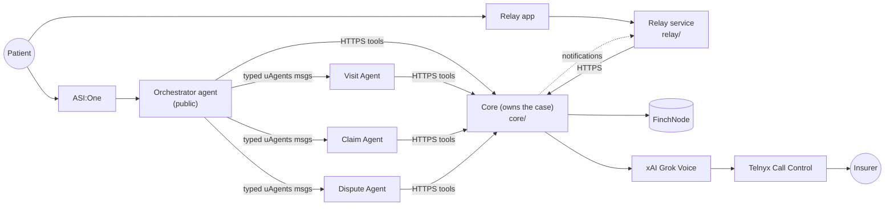

# Amyna

> **Hackathon prototype — all demo data is synthetic.** ClaimShield is **not
> HIPAA-compliant and not production-ready**. Do not use real patient data, member IDs,
> recordings, phone numbers or credentials. See [docs/SECURITY.md](docs/SECURITY.md).

Amyna helps patients review healthcare bills. It compares billed claim lines against
patient-authorized health records (FinchNode), appointment evidence (a recorded and transcribed
visit), and billing/code/policy knowledge. It finds discrepancies, asks the patient to confirm
uncertain items, and prepares evidence-backed disputes. Only after explicit patient approval
can it call the insurer with xAI Grok Voice over SIP, and it hands off to a human whenever
sensitive information is requested.

Everything runs end to end in **mock mode with zero credentials**. Each teammate drops in
keys and flips one `*_MODE` flag to go live ([docs/SETUP_KEYS.md](docs/SETUP_KEYS.md)).

## Quick start

Requires Python 3.11+ (3.11–3.13) and Node 20+. Docker is optional.

```bash
make setup        # .venv + editable installs, npm install, .env from .env.example (all mock)
make test         # Python (shared, core, intelligence, finchnode, fetch incl. real uAgents) + Node
make smoke        # full mock E2E through the real Core HTTP API (what CI runs)
make dev-local    # Core on http://localhost:8080/docs (SQLite, Alembic-migrated)
make seed         # synthetic demo patient with a recorded, transcribed visit
make chat         # the ASI:One conversation, offline (LOCAL_DIRECT agents)
make relay-demo   # the Relay patient conversation (mock Relay adapter)
```

`make dev` runs Core + Postgres with docker compose. `make help` lists every target.

## How it fits together



- **Core owns the case**: state machine with guards, consent, audit, tools, voice calls.
- **Agents** exchange typed messages and use Core's `/internal/tools/*`; they never touch the DB or FinchNode.
- **Relay** and **ASI:One** are interfaces only.
- **Safety in code**: no call without an APPROVED dispute and stored patient authorization;
  SSN/PIN/password/auth-code/DOB requests pause the call for a human; the voice agent cannot state
  codes or medical facts that aren't in the case evidence; dialing is allowlisted.

Details, diagrams and the decision log: [docs/ARCHITECTURE.md](docs/ARCHITECTURE.md).

## Repository map

| Path | What | Owner / branch |
|---|---|---|
| `core/` | FastAPI Core: DB (SQLAlchemy 2 + Alembic), state machine, auth, audit, tools, adapters, voice manager | Member 1 · `main` |
| `shared/` | Contracts: Pydantic models, HTTP + tool schemas, uAgents messages, OpenAPI, generated TS | Member 1 · `main` |
| `relay/` | Relay patient-experience service (Node/TS) | Member 2 · `branch-1-relay` |
| `fetch/` | uAgents orchestrator + specialists, pure logic, local_direct runner, Agentverse docs | Member 3 · `branch-2-fetch` |
| `finchnode/` | FinchNode client (mock / demo / sandbox), normalization, tools | Member 4 · `branch-2-fetch` |
| `intelligence/` | Extraction (rules / Qwen3), code resolver, hospital prices, policy RAG, discrepancy engine | Member 4 · `branch-2-fetch` |
| `scripts/` | smoke E2E, OpenAPI export, TS codegen, seed, branch setup | Member 1 |
| `docs/` | Architecture, contracts, state machine, security, keys, VERIFY list, demo, workflow | Member 1 |

Each branch folder has a `BRANCH_TASKS.md` (`relay/`, `fetch/`, `finchnode/`, `intelligence/`).

## Integration modes

| Flag | Values (default first) | Owner |
|---|---|---|
| `FINCHNODE_MODE` | `mock` · `demo` · `sandbox` | M4 |
| `EXTRACTION_MODE` | `rules` · `ollama` | M4 |
| `FETCH_MODE` | `local_direct` · `agentverse` | M3 |
| `RELAY_MODE` | `mock` · `live` (Relay service) | M2 |
| `NOTIFY_MODE` | `outbox` · `relay_service` (Core → Relay service) | M1/M2 |
| `XAI_VOICE_MODE` | `mock` · `live` | M1 |
| `TELEPHONY_MODE` | `mock` · `live` (Telnyx Call Control → xAI SIP) | M1 |

A live flag without its keys stops startup with a message naming the missing variable.

## Docs

- [ARCHITECTURE.md](docs/ARCHITECTURE.md): rules, diagrams, **decisions**
- [CONTRACTS.md](docs/CONTRACTS.md): HTTP, tool and message contracts; versioning
- [STATE_MACHINE.md](docs/STATE_MACHINE.md): states, transitions, guards
- [SECURITY.md](docs/SECURITY.md): safety gates, auth, PHI handling, limitations
- [SETUP_KEYS.md](docs/SETUP_KEYS.md): per-sponsor key checklist
- [VERIFY_LIST.md](docs/VERIFY_LIST.md): every unverified sponsor detail
- [DEMO_SCRIPT.md](docs/DEMO_SCRIPT.md): ASI:One, Relay and voice/SSN-handoff demos
- [BRANCH_WORKFLOW.md](docs/BRANCH_WORKFLOW.md): branches, merging, contract changes

## Main branch next steps (Member 1)

1. Build-order step 9: xAI realtime (`core/app/adapters/xai_voice/live.py`) + Telnyx Call
   Control (`core/app/adapters/telephony/telnyx_sip.py`), working through `docs/VERIFY_LIST.md`;
   the insurer ⇄ xAI bridge completes on the Ed25519-verified `/voice/telnyx/webhook` route.
2. Build-order step 10, with Member 2: human takeover (join/transfer the call instead of
   "verify directly then tap Done").
3. Merge branch PRs, keep contracts and generated files in sync (`make contracts`), keep CI green.
